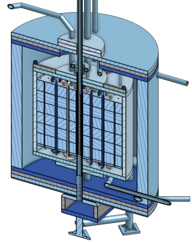

# are

detailed cad model and simulations of the [are](https://en.wikipedia.org/wiki/Aircraft_Reactor_Experiment) (aircraft reactor experiment), operated by oak ridge national laboratory 1954

## model

### are core

[docs/are.pdf](docs/are.pdf) lists reference of the are core design, documented in the ornl reports and located in the repository [github.com/openmsr/msr-archive](https://github.com/openmsr/msr-archive/blob/master/README.md)

work-in-progress cad model of the are can be found [here](https://cad.onshape.com/documents/b83e5f739a4507bf06f2a2a9/w/9511a6ac44a9e4d439d86976/e/36d3d4af112bbf8cad7d521b?renderMode=0&uiState=62d907b3549a2247567bee8c) on onshape.

note that this work and the cad model is under the GNU General Public License v3.0

## prerequisites
### CAD_to_openMC
[CAD_to_openMC](https://github.com/openmsr/CAD_to_openMC) is an open-source package to convert CAD geometry (in the form of '.step' files) into an openmc-readable h5m file

### openmc
These simulations use [openmc](https://docs.openmc.org/en/stable/). automated source installation scripts for linux can be found [here](https://github.com/openmsr/openmc_install_scripts)

## simulation guide
We have set up a set of helper scripts to run a set of standard simulations
with the ARE-geometry: k_eff, neutron_flux, ...

All these runs first check if the necessary set of three .h5m-files exist. If
they do, they ae used, of not a set will be created on the fly using the helper
script are_step_to_h5m.py.  Thus, should you wish to regenerate the set (or
part of it) you can simply move the files out of the way or run
are_step_to_h5m.py manually.

### k\_eff This is often the first simulation run done on a geometry which
estimates the reactivity or criticality of the reactor geometry.

### energy spectrum
This run defines an overall tally in the reactor geometry that measures the
energy of neutron within it, as well as a set of localized energy-scoring
tallies only scoring particles within:
1. fuel-salt within the reactor core
2. the reactor vessel wall.
3. the coolant salt.

Please note that even though the ARE reactor geometry describes a fluid
fuel-reactor, this simulation is a static steady-state run, meaning we
presently neglect depletion/burn-up and things like delayed neutrons.
It is possible to account for such effects, but is considere out-of-scope for
this set of sims.

### neutron_flux
This simulation run is very similar to k_eff, ecept that it adds a set of
mesh-tallies on slices through the reactor core. Each plane is set
to score the neutron-flux in the regions as a function of spatial coordinate, or more precisely flux binnned in cuboid volume elements in the planes.
The tallies predefined in the computations are a set of
XY|z\in{-50,-25,0,25,50} slices as well as slices at XZ|y=0, and YZ|z=0.
Tallies, and mesh-tallies in particular, create some extra overhead slowing the
simulations down somewhat - this is normal.

### geometry plot
This type of run is not a simulation run as such, instead it creates a set of
geometry slice plots aælong the principal axis. This is useful to make sure
that you are in fact simulating the geometry you think you are.
Lately, a new tool has been included the openmc-distribution: openmc-plotter,
which largely renders doing this type of run manually moot. The plotter does perform a geometry plot-run in the background.

# Jupyter notebooks
All this is also put together in a jupyter notebook that may be found in the subdirectory jupyter.
